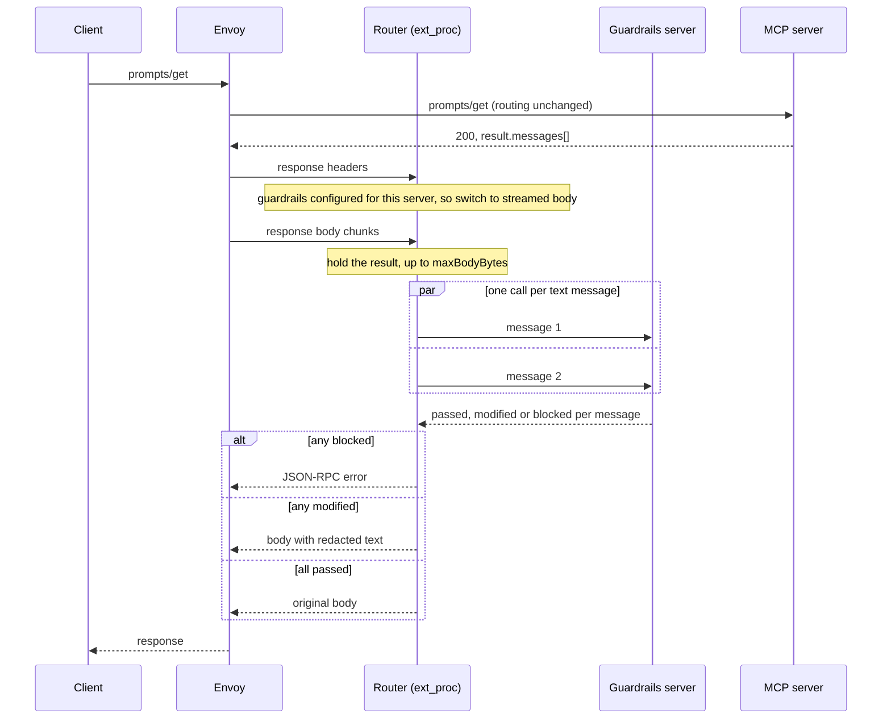

# Guardrails for Prompts

## Problem

The [guardrails integration](guardrails-design.md) checks `tools/call` requests, elicitation responses and `tools/call` responses. It does not check `prompts/get` responses. A prompt result is a list of messages the client can pass to the LLM. A compromised or malicious MCP server can return poisoned content through `prompts/get` today and nothing at the gateway inspects it. This is the same threat as a poisoned tool response through a different primitive.

## Summary

Extend the existing response-side guardrails path to `prompts/get`. When the target server has effective guardrails config IDs (per-server or global), the router buffers the `prompts/get` response, sends each text message to the guardrails server, and blocks, redacts or releases the result. The `Checker`, config resolution, `failMode`, `maxBodyBytes` and response buffering are reused, with no new CRD fields or annotations. New pieces are text extraction from a prompt result, the NeMo translation for a prompt message, and a JSON-RPC error as the block response, since `prompts/get` has no `isError`.

## Goals

- Check `prompts/get` response content before it reaches the client, on both the 2025-11-25 and 2026-07-28 protocol versions
- Reuse the existing guardrails config, resolution order, `failMode` and size limits
- Preserve message roles when translating to the guardrails server
- Add one method to the `Checker` interface and leave the existing methods unchanged

## Non-Goals

- Checking `prompts/get` requests (client-supplied `arguments`)
- Checking `prompts/list` descriptions
- Replacing server-side hardening (see Security Considerations)
- Inspecting binary or referenced content (`image`, `audio`, `resource.blob`, `resource_link`)
- Checking `inputRequests` in a 2026-07-28 `InputRequiredResult` (see Open Questions)

## Job Stories

### When I want prompts guarded like tool responses

When a platform engineer has guardrails enabled for an MCP server, they want `prompts/get` results checked the same way tool results are, so that injected instructions or sensitive content in a prompt are caught before they reach the LLM.

### When a prompt is partly unsafe

When one message in a multi-message prompt trips a rail, the platform engineer wants the whole result blocked or the message redacted, not silently forwarded.

### When I pick a prompt in my client

When an MCP client user picks a prompt, they want the prompt unchanged when it passes, the redacted prompt when guardrails modify it, and a clear error when it is blocked, so that they know whether the prompt ran and can ask the platform engineer if it was blocked.

### When my server's prompt gets blocked

When an MCP developer's prompt is blocked, the client receives a generic error and the rail name is only in the gateway logs. They want the logs to identify the prompt and rail so they can fix the server, since guardrails do not replace securing it.

### When an agent fetches prompts without a human in the loop

When a non-interactive agent calls `prompts/get` and the result is blocked, it receives a JSON-RPC error it can handle like any other failed request. With the default `failMode: deny`, content that was never checked does not reach its LLM. With `failMode: allow`, a check that times out releases the result unchecked.

## Design

### Prerequisites

Guardrails are already configured for the gateway or the target server, as described in the main design. A prompt check runs when the request is `prompts/get`, the upstream returns 200, and the route has effective config IDs (the `GuardrailsConfigured` test used for `tools/call`).

### Flow



After the upstream responds, `HandleResponse` decides whether to check, and the router switches the response body to streamed mode. The router then withholds the result itself with `guardrailsResponseBuffer`: SSE responses hold back only the final result event, JSON responses are held in full, both capped at `maxBodyBytes`.

### Extraction

A new extractor parses a `prompts/get` result ([MCP prompts spec](https://modelcontextprotocol.io/specification/2025-11-25/server/prompts)):

```json
{
  "description": "...",
  "messages": [
    {"role": "user", "content": {"type": "text", "text": "..."}},
    {"role": "assistant", "content": {"type": "resource", "resource": {"uri": "...", "text": "..."}}}
  ]
}
```

Inspected: `content.text` for `type: "text"`, and `content.resource.text` for `type: "resource"`. Not inspected: `image`, `audio`, `resource.blob`, `resource_link`, and the top-level `description`. As with `tools/call`, a body that cannot be decoded as a JSON-RPC response fails closed rather than passing through unchecked.

On 2026-07-28 every result carries `resultType`, and `"input_required"` marks an `InputRequiredResult` (`inputRequests`, `requestState`), which has no `messages`. A result with `resultType: "input_required"` and no `messages` passes through, as an `InputRequiredResult` from `tools/call` does today. Any other result without `messages` is not a valid `prompts/get` result and fails closed, so a server cannot skip the check by leaving `messages` out. This is stricter than `tools/call`, which passes any result with no text items. If `messages` is present it is checked whatever the `resultType`. 2025-11-25 has no `resultType`, so a result without `messages` always fails closed there.

### Granularity

Each text-bearing message is checked in its own guardrails call, so the MCP `role` is preserved in the translation and a redaction applies to one message. How a guardrails server uses the role is provider-specific; the mapping passes it through unchanged. Calls run concurrently with bounded fan-out. Any blocked message blocks the whole result. All calls for one result share a single deadline equal to the existing per-call timeout (`checkTimeout`, 8s), so total latency stays inside the 10s ext_proc `message_timeout` however many messages there are. A call that has not finished at the deadline is resolved by `failMode`, like any other timeout.

### Translation Mapping (NeMo)

#### Response: `prompts/get` message → `v1/checks`

| MCP field | NeMo field |
|-----------|------------|
| prompt name (from request context) | `messages[0].name` |
| `messages[i].content.text` or `.resource.text` | `messages[0].content` |
| `messages[i].role` (`user` or `assistant`) | `messages[0].role` |
| from config | `guardrails.config_ids`, `model` |

### Decision Mapping

| Outcome | Router action |
|---------|---------------|
| `status: "passed"` for all messages | Release original body |
| `status: "modified"` on a message | Replace that message's text with the modified content, forward |
| `status: "blocked"` on any message | JSON-RPC `error` response, discard buffer |
| Exceeds `maxBodyBytes` | JSON-RPC error. Tools return an `isError` result here, but prompts have none. `failMode` does not apply |
| Guardrails server non-2xx or timeout | Apply `failMode` |
| Undecodable response body | Fail closed |
| `resultType: "input_required"` with no `messages` | Release original body |
| Any other result with no `messages` | Fail closed |

A blocked prompt returns a JSON-RPC `error` object, not an `isError` result, because `prompts/get` results have no `isError` field. The existing `BuildJSONRPCError` and `BuildSSEJSONRPCError` (code `-32000`, as for request-side rejections) already produce this. The message is generic (`blocked by guardrails`); the rail name is logged, not returned.

### Component Responsibilities

| Component | Change |
|-----------|--------|
| `internal/guardrails/api`, `internal/guardrails` | Add `CheckPromptResponse(ctx, promptName, role, content, configIDs)` to the `Checker` interface and implement it in `nemoChecker`. The five test fakes of `Checker` (in `internal/routing` and `internal/mcp-router`) must add the method. `CheckResponse` is unchanged |
| `internal/guardrails/external/nemo` | `TransformPromptMessage`, mapping the role through instead of fixing it to `assistant` |
| `internal/routing` | Both `HandlePromptGet` implementations copy `route.GuardrailsConfigIDs` onto the request, as `tools/call` does today. Both `HandleResponse` implementations enable buffering for `prompts/get`. Prompt check helper beside `checkToolCallResponse` |
| `internal/mcp-router` | Prompt result extractor, JSON and SSE redacted-result builders, method switch in the adapter's guardrails block |
| Broker, controller, CRDs, Secret | No change |

Tracing and metrics for guardrails checks are tracked in #1548. Prompt checks should be covered there rather than adding separate instrumentation here.

## Security Considerations

- **Defense in depth:** Guardrails reduce the chance that poisoned prompt content reaches the LLM. MCP server admins still need to protect and update their servers, because a passed check does not guarantee a prompt is safe.
- **Fail closed by default:** same as for tools. Chunks that arrive after the result has been resolved are discarded, not forwarded unchecked.
- **Generic error bodies:** Rail names and guardrails server detail are logged, not returned to the client.
- **Data handling:** The guardrails server sees prompt content, so the considerations in the main design apply unchanged.

## Open Questions

These are the decisions where reviewer input would change the design.

### Per-message calls versus one call

Per-message preserves roles and keeps redaction simple, but a prompt with many messages costs many round trips. A single concatenated call is cheaper and loses the role and per-message redaction. Should there be a cap on messages checked, and what happens above it?

### One deadline for all messages in a result

The design gives all per-message calls for one result a single deadline equal to `checkTimeout` (8s), so a many-message prompt cannot run past the 10s ext_proc `message_timeout`. The cost is that a slow guardrails server can leave later messages unchecked at the deadline, and `failMode` then decides for them. The alternative is a per-call 8s timeout with a cap on the number of messages checked. Which is preferred?

### Default-on for existing configurations

Servers that already have guardrails config IDs will see `prompts/get` checked after upgrade, and a prompt that worked before can now be blocked. This follows from configuring guardrails for a server, but it is a behavior change that needs a release note under `docs/release-notes/`. Should it also be opt-out per server?

### Embedded resource text

Embedded `resource.text` goes into LLM context directly in a prompt, so this design inspects it. `tools/call` responses currently inspect only `text` items. Should the two be aligned?

### `InputRequiredResult` content

On 2026-07-28, `prompts/get` and `tools/call` can return an `InputRequiredResult` whose `inputRequests` carry server-written text that reaches the user or the LLM. Neither path checks it today. Should that be a separate change covering both?
