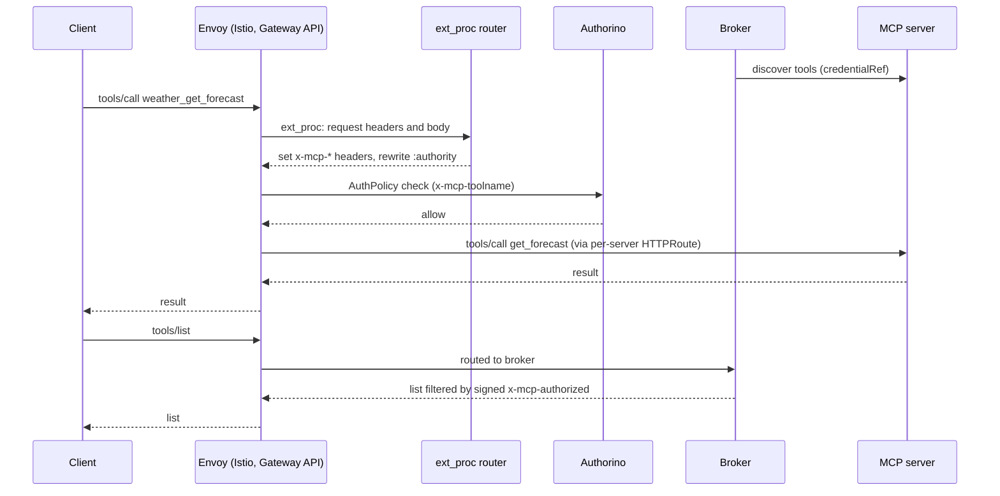
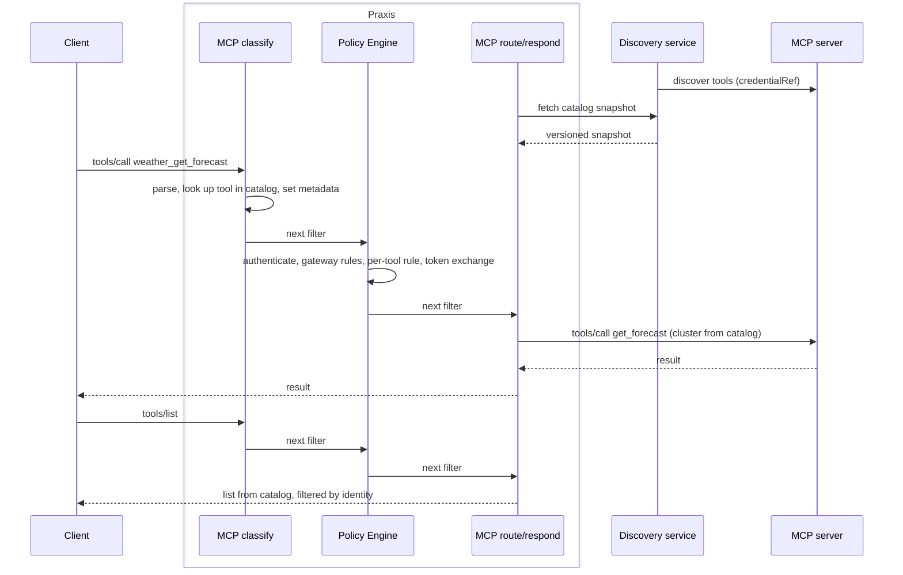

# MCP Gateway on Praxis

## Contents

- [Problem](#problem)
- [Summary](#summary)
- [Goals and non-goals](#goals-and-non-goals)
- [Design](#design)
  - [Today and target](#today-and-target)
  - [Data plane: ideas 1–6](#data-plane-ideas-16)
    1. [Split the broker into a discovery service](#1-split-the-broker-into-a-discovery-service)
    2. [Filter lists in-process](#2-filter-lists-in-process)
    3. [Deliver the catalog as versioned snapshots](#3-deliver-the-catalog-as-versioned-snapshots)
    4. [Route by catalog lookup](#4-route-by-catalog-lookup)
    5. [Separate filter chains per protocol version](#5-separate-filter-chains-per-protocol-version)
    6. [Replace the hairpin with an in-process sub-request](#6-replace-the-hairpin-with-an-in-process-sub-request)
  - [Control plane: ideas 7–11](#control-plane-ideas-711)
    7. [AIGateway with MCP enabled](#7-aigateway-with-mcp-enabled)
    8. [MCPServer names its backend directly](#8-mcpserver-names-its-backend-directly)
    9. [Policy is written on the gateway and server](#9-policy-is-written-on-the-gateway-and-server)
    10. [Gateway endpoints](#10-gateway-endpoints)
    11. [Isolation by tenant](#11-isolation-by-tenant)
  - [What each resource uses instead](#what-each-resource-uses-instead)
- [Security considerations](#security-considerations)
- [Open questions](#open-questions)
  - [For the AI Gateway API](#for-the-ai-gateway-api)
  - [For the Praxis Core API](#for-the-praxis-core-api)
  - [Migration](#migration)

## Problem

MCP Gateway runs only on an Envoy-based Gateway API stack (Istio or Envoy Gateway). Envoy doesn't understand MCP, so the MCP logic is spread across an ext_proc router that classifies requests and sets `x-mcp-*` headers, Authorino applying per-tool AuthPolicy rules, and a broker that answers list calls, holds sessions and discovers upstream tools.

Several parts exist only to work around Envoy and ext_proc: `:authority` routing with `*.mcp.local` HTTPRoutes, a dedicated MCP port, the signed `x-mcp-authorized` header, the `initialize` hairpin and per-request body-mode switching. Users also have to install Gateway API and an implementation of it just to run MCP Gateway.

## Summary

Serve MCP Gateway through [Praxis](https://github.com/praxis-proxy/praxis), with no Envoy, Istio or Gateway API. Praxis understands MCP inside the proxy, so classification, per-tool authorization, catalog serving and routing happen in one process. A separate discovery service talks to upstream servers and keeps discovery credentials out of the proxy.

Users configure MCP through the proposed AI Gateway API (`aigateway.praxis.io`): MCP is a protocol on an `AIGateway`, each upstream server is an `MCPServer`, and auth and rate limits are written on those resources as `governance`. The AI Gateway controller turns them into Praxis Core API resources. This replaces what Gateway API and Kuadrant policy attachment do for us today.

MCP Gateway 2.0 ships on Praxis. 1.x is the last release line on Envoy, and upgrading is a one-time cutover. The order of work will be planned once this approach is agreed.

## Goals and non-goals

**Goals:**

- MCP traffic goes through Praxis, with no Envoy in the request path.
- MCP Gateway installs with no Gateway API CRDs, Istio or Envoy Gateway.
- Discovery credentials (`credentialRef`) never reach the proxy.
- A documented one-time migration from 1.x (see [Migration](#migration)).

**Non-goals:**

- Changing the MCP protocol behaviour clients see.
- Porting Envoy-specific workarounds.
- Porting guardrails, which are agreed to land in Praxis.

## Design

### Today and target

Today a `tools/call` crosses Envoy, the ext_proc router and Authorino, and list calls go to the broker:



On Praxis, everything client-facing runs in one proxy, and discovery stays separate:



**Request pipeline.** Each request passes three stages, in this order:

1. **MCP classify:** parses the JSON-RPC body, looks up the tool or server, and sets metadata: method, tool, server, cluster. For a `tools/call`:
   - a server in the snapshot: the exact tool name must be in the catalog
   - a per-user server (idea 3): the prefix picks the server, and the tool name must pass its `toolFilter`
   - anything else is rejected
2. **Policy Engine:** authenticates the client, applies gateway and server rules (idea 9), and does any token exchange for the target server.
3. **MCP route/respond:** answers from the catalog (lists filtered by identity, `server/discover`), or sets the cluster, strips the prefix and forwards.

Classify must come before policy, because per-tool rules need the tool. Respond must come after, because list filtering needs the identity. This order is a security property.

### Data plane: ideas 1–6

These ideas change parts of the design that exist because of ext_proc. ext_proc can send a single immediate response but can't stream SSE or hold sessions, and every exchange is a gRPC round trip, so the router only sets headers and the MCP server work runs as a separate backend. Praxis filters run inside the proxy and can answer, stream and keep state.

#### 1. Split the broker into a discovery service

**Today:** the broker talks to upstream servers (with `credentialRef`, watching `list_changed`) and is also the MCP server clients talk to.

**On Praxis:** a Go discovery service keeps the upstream job and is the only place `credentialRef` lives. A Praxis filter holds the catalog in memory and answers 2026-07-28 `server/discover`, `tools/list`, `prompts/list` and `resources/list`. The 2025 protocol family runs in Praxis too, as its own chain (idea 5), and 2.0 has no client-facing broker. 2025 is stateful, so its sessions need more design (see 2025 sessions below).

**Why:** if discovery moved into the proxy, long-lived credentials that can see every tool would sit in the component handling every client request, and a slow upstream could affect client traffic. Splitting keeps today's guarantee and removes the hop to the broker for list calls.

#### 2. Filter lists in-process

**Today:** Authorino signs `x-mcp-authorized` (ES256) so the broker, a separate process, can trust the user's identity when filtering `tools/list`.

**On Praxis:** the respond stage runs after the Policy Engine in the same process and uses its identity and decision directly. There's nothing to sign, and the key pair goes.

#### 3. Deliver the catalog as versioned snapshots

**Today:** the controller writes a config Secret, and the broker builds the routing table in the router's process.

**On Praxis:** static wiring (clusters, prefixes, TLS, policy) goes in the generated `Proxy`. Discovered tools change at runtime, so the MCP filter pulls versioned snapshots from discovery and swaps them in atomically.

- **Failure:** a failed refresh keeps the last good snapshot, up to a configurable maximum age. Past that age, or with none loaded, the filter fails closed and reports the snapshot as stale.
- **Readiness:** a replica is ready only once its first snapshot loads. Later failures don't affect readiness, so a discovery outage doesn't remove every replica.
- **Convergence:** replicas reach the same version within one refresh interval, and report their version as a metric.
- **Access:** snapshots hold the full catalog, so only the gateway's own Praxis may read them. mTLS is required: each `AIGateway` has its own discovery, which rejects any connection without that gateway's client certificate. Certificates are issued per `AIGateway` and rotated without a restart. A failed handshake counts as a failed refresh. The controller also generates a NetworkPolicy that admits only that gateway's Praxis pods, as a second layer. The `mcp` filter can't present a client certificate yet (Core API open question 1), and 2.0 doesn't ship until it can. Development builds before then run without it.
- **What staleness affects:** only list contents. Removing an `MCPServer` republishes the `Proxy` and removes its cluster, so its tools stop working without discovery. `toolFilter` and per-tool rules are in the `Proxy` and `Policy`, not the snapshot, so changes to them apply without discovery too. A tool removed upstream is rejected by the upstream.

**Per-user tool lists (`userSpecificList`).** Some servers return different tools per user. Today `userSpecificList: Enabled` (which requires a `prefix`) makes the broker fetch that server's list on every `tools/list` with the user's headers, in parallel, with a timeout, leaving the server out on failure. It does the same for 2026-07-28 servers whose cache hints forbid sharing. On Praxis:

- Discovery doesn't list these servers into the snapshot. It marks them per-request, including servers whose 2026 cache hints say so.
- On `tools/list`, after the Policy Engine, the respond stage fetches their lists with the user's credentials, never `credentialRef`, merges them and applies the user's rules. A failing server is left out and counted in a metric.
- On `tools/call`, classify finds these servers by prefix and checks the exact tool name against the server's `toolFilter` before forwarding. Per-tool rules still apply.

This needs parallel sub-requests from a filter. Praxis core's `SubRequestClient` exists, but fan-out to several upstreams isn't built yet. If such a server needs an exchanged token, the Policy Engine must provide one per server in a single request.

#### 4. Route by catalog lookup

**Today:** `:authority` is rewritten to made-up `*.mcp.local` hosts with one HTTPRoute per server, MCP gets its own port so ext_proc doesn't see other traffic, and the router relies on `ClearRouteCache` and buffered-body tricks.

**On Praxis:** the MCP filter sets the cluster from the catalog. Each `MCPServer` is one cluster.

#### 5. Separate filter chains per protocol version

**Today:** one adapter picks `Router202511` or `Router202607` per request.

**On Praxis:** each version has its own chain. A listener runs all its chains as one pipeline, so each version's filters carry a condition on `MCP-Protocol-Version`. The 2025 chain takes every request that isn't `2026-07-28`, as the router does today: `2025-03-26`, `2025-06-18`, `2025-11-25`, and requests without the header, since only 2025 clients may omit it. Users only enable `protocols.mcp` (idea 7), and the controller generates both chains. Removing 2025 later means deleting one chain.

#### 6. Replace the hairpin with an in-process sub-request

**Today:** the 2025 lazy `initialize` goes back out through Envoy so policy applies to it, which needs the `router-key` JWT, `mcp-init-host` and a hairpin CA bundle.

**On Praxis:** classify has already found the target server and the Policy Engine has done any token exchange, so the respond stage sends `initialize` directly with those credentials. All of the hairpin pieces go.

#### 2025 sessions

How Praxis holds 2025 sessions, and where the store lives (ours, or praxis-ai's session work in ai#156 and ai#179), needs more design. Whatever it is must keep today's behaviour ([session management](../session-mgmt.md)):

- The gateway issues the client's session ID as a signed JWT, and the JWT alone decides validity.
- Backend sessions are created lazily on the first call to a server, keyed by gateway session and server, and kept in a store shared by every replica.
- A session works on any replica and survives restarts.
- `DELETE` removes the gateway session and every backend session mapped to it.
- A 404 from a backend drops that mapping, and the next call initializes again.
- Backend session IDs never reach the client.

#### Upstream TLS

Today users configure upstream TLS for tool calls in Istio or Gateway API, and the CA refs only reach the broker. On Praxis the controller writes each server's CA refs into its cluster TLS, as Secret references (the Core API manages file paths). Without this, calls to HTTPS upstreams fail.

| Trust material | Today | On Praxis |
| --- | --- | --- |
| System roots | Broker to upstream, 2025 hairpin | Discovery and Praxis to upstream |
| `caCertBundleRef` | Broker to upstream, hairpin to the gateway | Discovery to upstream, Praxis cluster TLS |
| `caCertSecretRef` | Broker to upstream only | Discovery to upstream, that server's cluster TLS |

### Control plane: ideas 7–11

Once Praxis routes by catalog lookup, Gateway API no longer carries MCP traffic. It still hosts the listener, identifies each server's backend, gives Kuadrant policies a target and isolates teams. Ideas 7–11 move each of those into two proposals:

- **AI Gateway API** (`aigateway.praxis.io/v1alpha1`, *Proposal: AI Gateway Kubernetes control plane*): users write `Tenant`, `AIGateway`, `Model` and `MCPServer`, never listeners, filter chains, policy documents or `targetRef` policies. Defaults are reused through `baseRef` to a `*Config`, non-standard connectors use `extRef`, and the only escape hatch is `proxyRef` to a hand-written `Proxy`. One controller renders the lower layer from an editable **generation template** (a ConfigMap), merged with `AIGatewayConfig` and then the `AIGateway`.
- **Praxis Core API** (`praxis.io/v1alpha1`): a `Proxy` holds the whole proxy with filter chains inline, and a `Policy` holds a Policy Engine document. Core renders native config (in a ConfigMap at first) and runs the Deployment and Service. Settings are typed, not free-form YAML. The AI Gateway proposal calls the policy kind `PolicyFilter`; this document uses `Policy`.

Both are proposals. MCP fields and contracts below are our proposals for agreement, not settled API.

MCP Gateway's control plane becomes the MCP part of the AI Gateway API. We build the MCP fields and the code that turns them into MCP chains, clusters, endpoints and the discovery service. Because the Core API expects one complete `Proxy` per gateway, that code runs inside the AI Gateway controller.

#### 7. AIGateway with MCP enabled

**Today:** `MCPGatewayExtension` extends someone else's Gateway: it targets a listener, installs an EnvoyFilter, manages the gateway HTTPRoute and needs a ReferenceGrant. Most of its other fields (hostnames, OAuth metadata, sessions, elicitation) aren't about Envoy.

**Proposed:** MCP is a protocol on an `AIGateway`. Each `AIGateway` belongs to one `Tenant` and is one Praxis instance. For each one with MCP enabled, the controller generates:

- one `Proxy`, shared with the gateway's other protocols, with MCP's listener, chains and endpoints, and one cluster per `MCPServer`. It must use a praxis-ai image, since the `mcp` filter isn't in core Praxis.
- a `Policy` built from `governance` (idea 9)
- the discovery service, which isn't a Core resource

The MCP settings from `MCPGatewayExtension` move under `protocols.mcp`, which we would add:

```yaml
apiVersion: aigateway.praxis.io/v1alpha1
kind: AIGateway
metadata: { name: team-alpha-gw, namespace: team-alpha }
spec:
  baseRef: { name: fleet-defaults }
  tenantRef: { name: team-alpha }         # immutable
  endpoint: { port: 8443, tls: { certificateRef: { name: mcp-tls } } }
  protocols:
    mcp:                                 # fields MCP Gateway adds
      publicHost: mcp.example.com
      oauthProtectedResource: {...}
  governance:
    authentication: [ { oidc: { issuerURL: https://sso.example.com } } ]
```

Adding or removing an `MCPServer` republishes the `Proxy` and reloads the pipeline. Discovered tools stay out of it (idea 3).

This depends on the Core API kinds with an operator that runs them without Gateway API (today's Praxis operator uses Gateway API and has no CRDs), and on the AI Gateway controller. Until they exist, a development-only MCP controller reads the same resources and deploys Praxis itself. It's removed before 2.0.

**Why the AI Gateway API:** one API for models, MCP servers and agents on the same gateway, with one way to write auth and limits. Our own `MCPGateway` kind would be a second gateway resource for the same proxy.

The `mcp.kuadrant.io` API group is retired: `MCPGatewayExtension`, `MCPServerRegistration` and `MCPVirtualServer` are removed. Virtual servers move to a tenant-namespaced kind (idea 10).

How 1.x users migrate is an open question (see [Migration](#migration)).

#### 8. MCPServer names its backend directly

**Today:** a registration's `targetRef` is an HTTPRoute with one backendRef, which can be in another namespace. The controller reads that Service without checking a ReferenceGrant.

**Proposed:** an `MCPServer` names its owning tenant and its backend. The backend is either a same-namespace `serviceRef` (as `ModelProvider` uses) or an external `endpoint` URL from an allow-list the provider admin sets on the `Tenant`. The controller rejects an `MCPServer` whose URL isn't on the list and reports it in status. Discovery and Praxis only get backends from controller-generated config, so both outbound paths are covered, and removing a URL from the list removes the cluster and the discovery target. Cross-namespace Service references are out of scope: Praxis forwards tool calls itself, so allowing them would let anyone who can create an `MCPServer` reach any Service. A grant could be added later if there's demand.

```yaml
apiVersion: aigateway.praxis.io/v1alpha1
kind: MCPServer
metadata: { name: weather, namespace: team-alpha }
spec:
  tenantRef: { name: team-alpha }
  backend:
    serviceRef: { name: weather-server, port: 8080 }   # same namespace
    path: /mcp
  toolFilter: { allow: ["get_*"] }
  toolPrefix: weather_            # fields MCP Gateway adds
  credentialRef: {...}            # discovery only
  governance: {...}               # idea 9
```

We would add today's registration fields: prefix, path, `credentialRef`, CA refs and `userSpecificList`.

- **`toolFilter`** sets which tools the tenant can see at all. Discovery drops the rest from lists, and the controller also writes it into the `Proxy`, so the `mcp` filter checks the exact tool name on every `tools/call`, including servers fetched per request. Per-identity rules (idea 9) decide who may call the rest.
- **`credentialRef`** is read only by discovery, and must be in the tenant's `authorizedCredentials`.

**Credentials** have three separate lifecycles:

| Credential | Lifecycle | Boundary |
| --- | --- | --- |
| Discovery `credentialRef` | Resolved by discovery, rotated without a restart | Never in snapshots, proxy config or tool calls |
| Per-user MCP token | Forwarded or exchanged by the Policy Engine. URL elicitation keeps user tokens encrypted in the session store | Only for that user's upstream access |
| `ModelProvider.credentials` | Resolved and injected per request, then discarded | A separate model contract. MCP's stored elicitation tokens need agreement |

#### 9. Policy is written on the gateway and server

**Today:** AuthPolicy and RateLimitPolicy target a Gateway listener or HTTPRoute.

**Proposed:** no policy attachment. Auth, authorization and rate limits are `governance` on the resource they apply to:

- `AIGatewayConfig`: defaults inherited by gateways through `baseRef`
- `AIGateway`: every request to the gateway
- `MCPServer`: calls to that server's tools

Each resource resolves its own `baseRef`, and a field it sets overrides the inherited value. An `MCPServer` doesn't inherit from its `AIGateway`. Kuadrant AuthPolicy and RateLimitPolicy don't target MCP resources. Rate limits run in the Policy Engine through the Limitador plugin ([policy#143](https://github.com/praxis-proxy/policy/issues/143)).

**Per-tool rules** are the main field we'd add. The AI Gateway example shows `authorization: [ { allow: { groups } } ]` on a `Model`. We propose adding `tools`, lowered to rules over `mcp.tool.name`:

```yaml
kind: MCPServer
spec:
  governance:
    authorization:
      - allow: { groups: [ team-alpha-dev ], tools: [ get_forecast ] }
```

**Enforcement contract** (to agree with the AI Gateway authors):

1. Authenticate once, against the gateway's issuers. Server-level authentication uses that identity and can't bring another issuer.
2. A request must pass both the gateway's rules and the server's. List filtering uses the same rules per tool. A server block can't weaken the gateway's.

The controller generates one Policy Engine document per gateway. In it, routes compete (the most specific wins), while the layers above stack onto the chosen route: `global`, `global.defaults.<entity>`, tag bundles including `all`, then the route. So the contract holds if the controller puts gateway rules in `global` and `all`, puts each server's rules in its route, and never sets `replace_inherited: true` on a server route.

**What MCP Gateway supplies to the controller:**

- **Scope:** an `MCPServer` block applies only to its tools (`mcp.tool.server_id`).
- **Chain order:** classify, then `policy`, then respond. Templates are editable, so the controller should check this order after rendering and refuse a `Proxy` that breaks it.
- **Policy check:** the controller validates the generated document before publishing and refuses one where a server route sets `replace_inherited`. The MCP chain must also not strip the caller's credential, unlike the inference chain.
- **Policy filter settings:** `require_protocol_metadata`, so unclassified requests fail closed, and the 401 resource metadata URL from `protocols.mcp`.
- **Attributes:** the `mcp` filter must fill the Policy Engine's `mcp.tool.*` attributes, which replace today's `x-mcp-*` headers.

**Migrating policies:** existing AuthPolicies are rewritten as `governance`, with a guide for the common patterns (JWT or OIDC, per-tool rules by role or group, request limits). Envoy-only parts, such as the signed `x-mcp-authorized` header, are dropped. For anything `governance` can't express, such as the token-exchange and Vault sample, `proxyRef` means owning the whole `Proxy`. We'd ask for a policy-level escape: a hand-written `Policy` in place of the generated one.

#### 10. Gateway endpoints

**Today:** the controller creates HTTPRoutes for the gateway, plus `/tokens` for URL elicitation, and virtual servers are chosen by header.

**Proposed:** MCP has its own listener on the gateway's `Proxy`, since the AI Gateway proposal gives each protocol one. The controller generates its routes:

- `/mcp`
- `/.well-known/oauth-protected-resource` as a static response
- `/tokens` for URL elicitation
- `/vmcp/<name>` for each virtual server

**Virtual servers** keep today's behaviour. A virtual server is a named list of prefixed tool and prompt names, possibly across several servers. On `/vmcp/<name>`, `tools/list` and `prompts/list` return only that set, after identity filtering. Calls aren't restricted to the set, and per-tool rules still decide who may call. The path replaces the `X-Mcp-Virtualserver` header. We propose keeping today's model as a tenant-namespaced kind with the same `tools` and `prompts` fields, so each `MCPVirtualServer` maps one to one. Whether the AI Gateway authors accept that kind is open question 7.

#### 11. Isolation by tenant

**Today:** listener ports, ReferenceGrants and conflict checks between extensions sharing a Gateway.

**Proposed:**

- **Isolation:** each `AIGateway` belongs to one `Tenant` (immutable `tenantRef`) and has its own Praxis pods. A tenant can run several gateways, but none is shared.
- **Identity:** comes from the Tenant's trusted issuers, never client headers. Policy, rate-limit keys, credentials, routing and telemetry all use it. Who may use a gateway is set by its `governance`, as AuthPolicy does today: tenants that share an issuer require an audience, claim or group on their gateway.
- **Admission:** an `MCPServer` names its Tenant and lives in its namespace, and is served by that Tenant's gateways. Choosing one of several gateways is our proposal. We depend on the AI Gateway API checking at admission that a resource's namespace belongs to the Tenant it names, for `AIGateway` as well (open question 10).
- **Revocation:** as today. Removing an IdP role or disabling a user takes effect from their next token, and API keys within the Policy Engine's cache window. The `Tenant.revocation` kill switch is future AI Gateway and Policy Engine work, not a 2.0 requirement.

The cost is more pods for many small teams, and no central team referencing other namespaces' Services.

### What each resource uses instead

| Resource | Relies on Gateway API today for | Uses instead |
| --- | --- | --- |
| `MCPGatewayExtension` | Listener target, gateway HTTPRoute, `/tokens` HTTPRoute, ReferenceGrant | `AIGateway` with MCP enabled (7, 10, 11) |
| `MCPServerRegistration` | HTTPRoute target, ReferenceGrant | `MCPServer` with a same-namespace Service or approved URL (8) |
| `MCPVirtualServer` | Gateway HTTPRoute, selected by header | A tenant-namespaced virtual server kind, served on `/vmcp/<name>` (10) |
| AuthPolicy, RateLimitPolicy | `targetRef` to a Gateway or HTTPRoute | `governance` on `AIGateway` and `MCPServer` (9) |
| Gateway, HTTPRoute, ReferenceGrant, Istio, Envoy Gateway | Themselves | Not needed |

A cluster that standardizes on Gateway API can still put its own Gateway in front of the Praxis Service.

## Security considerations

Some of these hold only once an open question is agreed: gateway and server rules both applying (AI Gateway question 1), the endpoint allow-list (question 4), tenant admission (question 10) and catalog mTLS (Core API question 1).

- **Discovery credentials stay out of the proxy.** Only discovery reads `credentialRef` (idea 1).
- **Identity before access.** Identity comes only from the Tenant's issuers, never client headers. The gateway's `governance` decides who may use it. Every request is authenticated, so a session doesn't outlive its token (idea 11).
- **The catalog fails closed** with no snapshot or one past its maximum age. Each gateway's discovery serves only that gateway, over required mTLS plus a NetworkPolicy (idea 3).
- **`toolFilter` is checked on every call,** not just in lists, so a guessed tool name can't reach an excluded tool (idea 8).
- **Default deny per tool** when per-tool rules apply. Gateway rules always apply too, and a server can't weaken them; the controller refuses generated policy that would (idea 9).
- **The MCP chain order is checked,** so per-tool rules can't be skipped by an edited template (idea 9).
- **Backends are admitted,** not just namespace-checked: same-namespace Services, or URLs on the Tenant's allow-list, checked by the controller (idea 8).
- **Tenant isolation** relies on resources only naming their own Tenant (idea 11).
- **No signed identity header in-process.** The `x-mcp-authorized` key pair goes, and client-sent internal headers are stripped (idea 2).
- **Narrower signing key.** `GATEWAY_SIGNING_KEY` no longer signs `backend-init` tokens. It still signs 2025 session IDs and protects stored user tokens, held only by the session owner.
- **Session isolation carries over:** signed gateway session IDs, backend sessions keyed by gateway session and server, and backend session IDs never reaching clients.
- **Smaller 2025 surface:** no hairpin, `router-key` or second policy pass (idea 6).

## Open questions

### For the AI Gateway API

1. **Do gateway and server rules both apply?** `governance` can be set on an `AIGateway` (every request) and on an `MCPServer` (that server's tools). The proposal says where a block lives sets its scope, but not how the two combine. If a server's rules could replace the gateway's, a server's owner could weaken the gateway's authentication or authorization for their server. We need a request to pass both, with server-level authentication using the identity the gateway established rather than another issuer. Will the controller generate policy that guarantees this? (idea 9)
2. **Can per-tool rules be standard governance?** MCP's core access control is "this group may call these tools". The end-to-end example shows `authorization: [ { allow: { groups } } ]` on a `Model`. We propose adding `tools` to that match, lowered to rules over `mcp.tool.name`, rather than needing an `extRef`. Does that shape work? (idea 9)
3. **Can MCP add its fields?** The proposal's `MCPServer` has `tenantRef`, a backend URL, `toolFilter` and `governance`, and `protocols.mcp` on `AIGateway` is empty. Today's features need, on `AIGateway`, a public host, OAuth protected-resource metadata, and session and elicitation settings. On `MCPServer` they need a tool prefix, path, a discovery-only `credentialRef`, CA refs, `userSpecificList`, and a same-namespace `serviceRef` like `ModelProvider` has. The proposal also gives each protocol its own listener, but `AIGateway.endpoint` holds a single port, so MCP's listener needs its own port, host and TLS settings. Can MCP Gateway contribute these? (ideas 7, 8, 10)
4. **Can the `Tenant` hold an endpoint allow-list?** Praxis forwards tool calls itself, so an `MCPServer` backend is where gateway traffic goes. We restrict `serviceRef` to the server's own namespace, and want external `endpoint` URLs only from an allow-list the provider admin sets on the `Tenant`, checked by the controller, so an `MCPServer` can't reach other tenants' Services or arbitrary hosts. Does that fit the API? (idea 8)
5. **Can there be a policy-level escape hatch?** The only escape is `proxyRef`, a whole hand-written `Proxy`. Complex existing AuthPolicies, such as token exchange with a Vault lookup, may not fit `governance`, and owning the whole proxy to customise one policy is heavy. Could a hand-written `Policy` replace the generated one, as `rateLimits.tokens.ref` does for token budgets? And who may set each escape, since either replaces generated policy? (idea 9)
6. **How does an `MCPServer` pick a gateway?** An `MCPServer` names its tenant and is served by that tenant's gateways. When a tenant runs several, some servers should only appear on one, for example an internal gateway. The AI Gateway proposal leaves this open (its open question 4). We propose an optional gateway selection on `MCPServer`. Does that fit? (idea 11)
7. **Can virtual servers be a tenant-namespaced kind?** Today an `MCPVirtualServer` is a named list of prefixed tool and prompt names that can span several servers, and it filters lists, not calls. Every gateway gets every virtual server, and a client picks one with the `X-Mcp-Virtualserver` header. On Praxis it becomes `/vmcp/<name>` on a tenant's gateway, so it needs a tenant-scoped home. We propose keeping today's model as a tenant-namespaced kind, so existing ones map one to one, rather than a field on each `MCPServer` (which spreads one virtual server across servers and makes curators edit servers they don't own) or tags plus a selector. Does that kind fit the AI Gateway API? Each path also needs its own OAuth metadata. (idea 10)
8. **Can the template protect MCP's chain order?** MCP needs classify, then `policy`, then respond, because per-tool rules need the tool name and list filtering needs the decision. That differs from chat, and MCP isn't normalised to Chat Completions. Templates are editable, so an edit could break the order and silently skip per-tool rules. Could the controller check the MCP chain order after rendering and refuse to publish a `Proxy` that breaks it, and keep the MCP chain from stripping the caller's credential as the inference chain does? (idea 9)
9. **How does our MCP code ship and run?** The Core API expects one controller to generate a complete `Proxy`, so MCP's chains and clusters must come from the AI Gateway controller, not a separate MCP controller. The MCP code also deploys a discovery service per gateway, a workload that isn't a Praxis resource. It could ship as a Go package compiled into the controller, as an extension service the controller calls, or only as chain shapes in the template, which can't cover per-server clusters or the discovery Deployment. We'd prefer a compiled-in package plus the chain shape in the template. Which fits the controller, and can it deploy the discovery service? (ideas 1, 7)
10. **How are tenants enforced?** Each `AIGateway` belongs to one tenant, and the proposal says a `Model`, `MCPServer` or `Agent` lives in its tenant's namespace. Is that enforced at admission, and does it apply to `AIGateway` too, so a resource can't name a tenant it doesn't belong to? And can MCP's first release ship without `Tenant.revocation`, which the Policy Engine doesn't provide yet? Revocation would stay as today: from the user's next token. (idea 11)
11. **Can MCP keep user tokens?** The proposal resolves provider credentials per request and discards them. MCP's URL elicitation instead keeps a token a user supplied, encrypted in the session store, for the rest of the session. Can that lifecycle be agreed as separate from `ModelProvider` credentials? (idea 8)
12. **Where does the code live, and how do releases line up?** An MCP Gateway 2.0 release would be our discovery image and MCP module, plus an AI Gateway controller built with that module, a praxis-ai image with our filters, and the Praxis Core operator, tested together. Which repository and organization host the AI Gateway API and controller? How does a fix in our module reach users if it waits for an AI Gateway release? And who packages the set downstream? (idea 7)

### For the Praxis Core API

1. **Can the discovery fetch use mTLS?** Praxis loads its MCP catalog from the discovery service, and that snapshot lists every tool on every server before per-user filtering. Only the gateway's own Praxis should be able to read it, otherwise any pod that can reach discovery sees the full catalog. That needs the `mcp` filter to present a client certificate when it fetches the catalog. How can a `Proxy` give a filter a client certificate? (ideas 3, 7)
2. **Can a `Proxy` be checked against its image before rollout?** The `Proxy` names filters such as `mcp` that only exist in praxis-ai builds, and the image is chosen separately from the config. If they don't match, running pods keep the old config without any error on the resource, and new pods fail to start, so scaling or a restart takes the gateway down. Can Core, or the controller, check a `Proxy` against its image and report a failure before publishing? (idea 7)

### Migration

1. **How do 1.x users move to 2.0?** 2.0 replaces every 1.x resource and policy with new kinds on a new proxy, so users need a supported path that doesn't break their clients. Today's gateway serves `/mcp`, `/mcp/stateful` and `/mcp/stateless`, and clients pick virtual servers with the `X-Mcp-Virtualserver` header. Which paths does 2.0 keep, and what do clients have to change? What's the sequence to install 2.0, convert resources, verify, cut over and roll back, and can 1.x and 2.0 run side by side while that happens? (ideas 7, 10)
